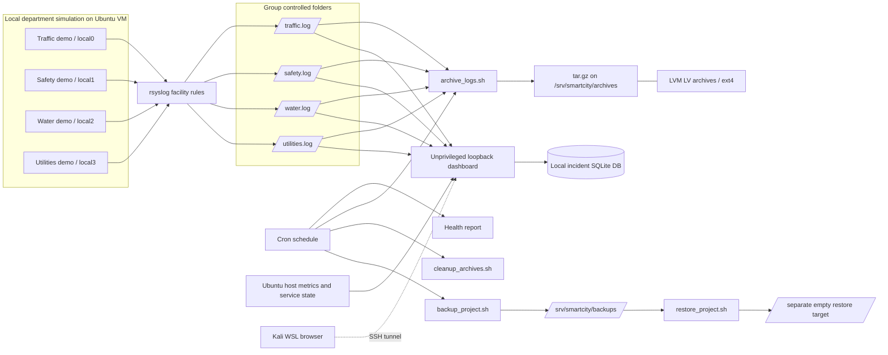

# Architecture — Smart City Command Centre

## Trust boundaries and notes

- All source events in the baseline demonstration are local `logger` messages using facilities `local0` through `local3`.
- The project does not enable remote syslog reception and does not open inbound port 514.
- Department directories are owned by root and the matching department group, with mode `2770` (setgid + group read/write/execute).
- The archive mount uses a dedicated empty disk only when one is supplied and approved. Creating a PV/filesystem erases the selected device.
- Cron jobs run as root in the provided schedule. The archive retains source logs; cleanup removes archive bundles older than 30 days.
- Backups reside on the same host by default and are not off-host disaster recovery.
- Ubuntu live dashboard mode runs as `smartcity-dashboard`, binds to loopback only, and reads fixed department log paths through read-only ACLs. Use SSH tunneling to view it from Kali; do not expose the dashboard port publicly.
- Kali WSL demo mode stores rehearsal incidents in a local SQLite file and reports WSL host metrics. It does not connect to the university VM.

## Data paths

| Data | Path |
|---|---|
| Installed scripts/config | `/opt/smartcity` |
| Department logs | `/srv/smartcity/logs/<department>/` |
| LVM archive mount | `/srv/smartcity/archives/` |
| Project backups | `/srv/smartcity/backups/` |
| Health/Cron reports | `/srv/smartcity/reports/` |
| Ubuntu dashboard database | `/var/lib/smartcity-dashboard/smartcity.sqlite3` |
